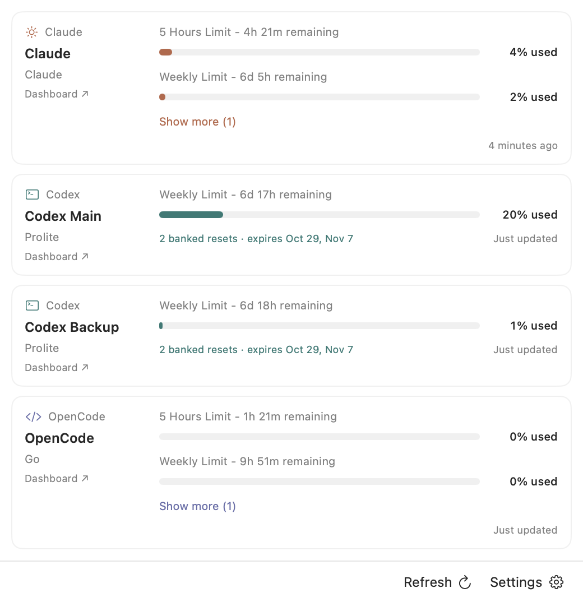
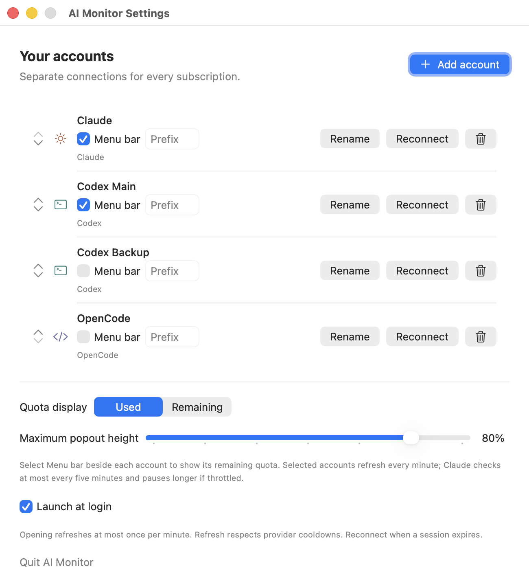
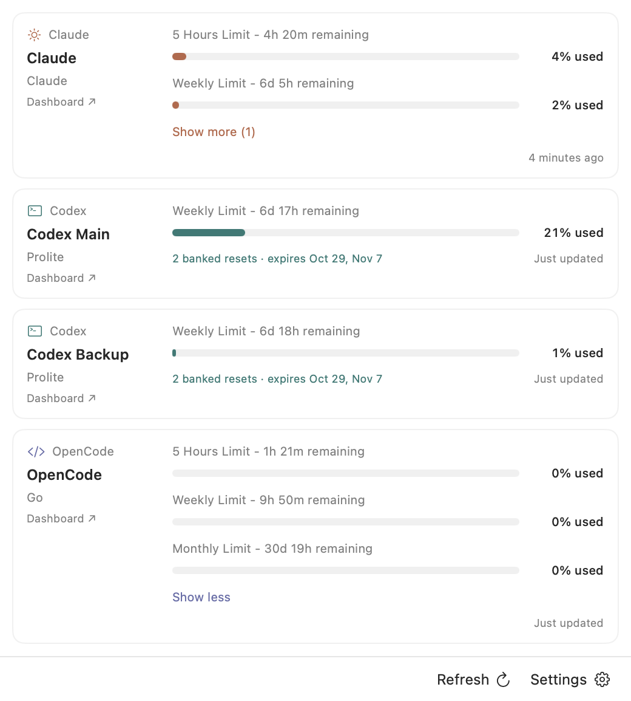

# QuotaBar for AI

A native macOS menu bar app for multiple Claude, Codex through ChatGPT, and OpenCode accounts. Requires macOS 14 or later. No third-party package dependencies.

## Install

[Download QuotaBar for AI for macOS](https://github.com/AfzalH/ai-monitor/releases/download/v0.1.21/QuotaBar-for-AI-0.1.21.zip)

Previously named AI Monitor. The current GitHub release is v0.1.21, build 22. The separate Mac App Store version, 1.0.0 build 20, is awaiting Apple review.

1. Download and unzip **QuotaBar-for-AI-0.1.21.zip**.
2. Drag **QuotaBar for AI.app** into **Applications**.
3. Open **QuotaBar for AI** and click the gauge icon in the menu bar to add your accounts.

Requires macOS 14 or later. The app supports Apple Silicon and Intel Macs and is signed with Developer ID and notarized by Apple. Enable **Launch at login** in Settings if you want it to start automatically.

When upgrading from the old bundle ID, remove its login item in System Settings and enable launch at login again for the updated app.

See [GitHub Releases](https://github.com/AfzalH/ai-monitor/releases) for release notes and SHA-256 checksums. To update, quit QuotaBar for AI and replace the app in Applications. Your saved accounts remain in Keychain and Application Support.

## Screenshots

See remaining quota for your selected accounts directly in the macOS menu bar.


Monitor multiple subscriptions, including separate Codex accounts, with reset countdowns and banked resets.



Choose which accounts appear in the menu bar, set optional prefixes, and adjust the popout height.



Expand an account to see additional limits, such as OpenCode Go's monthly quota.



## Build from source

```sh
./scripts/build-app.sh
open "dist/QuotaBar for AI.app"
```

Click the gauge icon in the menu bar, then **Add your first account**. The gear opens account management. You can move the app to Applications after building. Enable launch at login from its settings after moving it.

The menu bar can show several accounts, including multiple accounts from the same provider, with optional prefixes such as `x1 80% · x2 50%`. Each connected account row in Settings has its own Menu bar checkbox and prefix. Prefixes are empty by default. The first account is selected by default. Selections and prefixes stay with the account when renamed or reordered. Only selected accounts refresh in the background. Codex and OpenCode check once per minute. Claude checks no more often than every five minutes, across automatic and manual refreshes. Uncheck every account for an icon-only menu item. The compact popover shows 5-hour and weekly limits by default, with Show more for additional windows, plus reset countdowns and Codex banked resets. Settings contains the Used / Remaining switch, account renaming and ordering, and a maximum popout height control, defaulting to 40% of the screen. The popout shrinks to fit shorter lists. Usage refreshes on opening at most once per minute, including after failed attempts. Clicking Refresh bypasses the popout cooldown, but never a provider throttle. Other accounts refresh only on opening or manual refresh.

## Connect accounts

- **Claude:** default-browser authorization or a subscription OAuth access token. Browser authorization uses the Claude Code OAuth flow, with a temporary loopback callback and PKCE. The app receives the result automatically.
- **Codex:** default-browser authorization, an OAuth access token, or import a Codex `auth.json` file. Import current login respects `CODEX_HOME`, falling back to `~/.codex`. This monitors Codex usage through ChatGPT, not OpenAI API spending or ChatGPT chat-model limits.
- **OpenCode:** open the console in your default browser and paste a Go API key. An advanced console Cookie-header option lets you choose a workspace and detects Go versus prepaid Zen billing. Zen displays its balance and spending over the last 30 days, without inventing a subscription quota.

Add each subscription separately and give it a name. Claude and Codex browser sign-ins use separate authorization requests. Your default browser may already have a provider session, so select or switch to the intended account on the provider page when adding a backup. You can connect the same provider more than once.

Claude and Codex browser sign-ins renew their access tokens automatically. The app stores the refresh token in Keychain with the access token and renews shortly before expiry or after the provider rejects the token. Pasted access tokens, imported CLI credentials, and cookies cannot be renewed. Use **Reconnect** when prompted. Accounts connected before 0.1.20 have no refresh token, so reconnect them once. Use **Rename** to change a saved account name without signing in again. Imported CLI credentials are snapshots; the app never modifies the original auth file or redeems its refresh token, because doing so would sign the CLI out. No embedded browser is used. Claude opens your default browser and returns through a temporary localhost callback. Codex uses loopback port 1455, falling back to 1457 if occupied. Each callback requires the matching state and PKCE verifier. Sign-in times out after ten minutes and cancellation closes the listener. OpenCode has no automatic external-browser session transfer in this version.

## Local data

Credentials live in macOS Keychain under `com.srizon.quotabar.credentials`, with a different entry per account. Account names, provider names, and UUIDs live in `~/Library/Application Support/AI Monitor/accounts.json`. Upgrades from the old app copy readable credentials from `com.local.ai-monitor.credentials` and retain the original entries. The latest usage figures for each account are cached in `snapshots.json` in the same folder, so they appear immediately after a relaunch. Removing an account removes its Keychain entry and metadata.

Requests go directly to the selected provider. There is no backend, analytics, or credential logging. HTTP redirects are rejected for authenticated usage requests. No paid inference requests are used to measure usage. The app displays banked resets but never redeems them.

## Development

```sh
swift test
swift run AIMonitor --demo
```

Demo mode works when no real accounts have been added and never saves sample accounts. You can also enter it from the empty popover.

```sh
swift run AIMonitor --render-preview /tmp/ai-monitor-preview.png
```

The preview command renders sample data in isolation, without loading real account metadata or credentials.

`MonitorCore` contains usage parsing and network requests. `AIMonitor` contains SwiftUI views, account storage, Keychain access, and default-browser authorization. Tests use synthetic provider responses and an in-memory credential vault.

## Status and limits

The app builds locally and has automated parser, request-scope, persistence, and cancellation checks. Live provider sign-in and quota responses still need verification with your accounts. The default-browser handoff, callback rejection, cancellation, and token exchange are tested locally using synthetic credentials. The native UI automation service was unavailable during development, so menu interaction has not been automated.

Provider usage routes are mostly undocumented and can change. An unsupported response shows an error instead of zero usage. Failed refreshes preserve the previous snapshot and mark it stale. Optional Codex reset-credit failures do not hide working quota data. Missing reset times stay unknown.

The build script produces a universal Apple Silicon and Intel app, then signs it with a Developer ID Application certificate, hardened runtime, and a secure timestamp. It uses the same signing approach as `~/voice`, without that app's microphone or Apple Events entitlements. Set `CODESIGN_IDENTITY` to select a certificate, or `CODESIGN_IDENTITY=-` for an explicit local ad-hoc build. Set `AI_MONITOR_ARCHS=arm64` to build only for Apple Silicon.

To notarize the signed app and produce a distributable ZIP:

```sh
./scripts/notarize.sh
```

This uses the existing `vBoard-Notary` Keychain profile. Override it with `NOTARY_PROFILE` if needed. Credentials remain in Keychain. The script submits the ZIP to Apple, waits for acceptance, staples the ticket to the app, verifies Gatekeeper acceptance, and rebuilds the ZIP with the ticket included. Outputs are `dist/QuotaBar-for-AI-<version>.zip` and its SHA-256 checksum.

The submission ID is saved in `dist/notarization-submission.json`. If waiting times out, run `./scripts/notarize.sh SUBMISSION_ID` to resume without submitting again. Do not rebuild or modify the app between submission and stapling. A rebuild needs a new notarization submission.

Protocol research used the public [CodexBar provider documentation](https://github.com/steipete/CodexBar/tree/main/docs) and corresponding fetchers, with an independent implementation here. See [provider notes](docs/providers.md).

### Claude request throttling

We could not find an official request budget for the subscription OAuth usage endpoint. The five-minute interval is this app's conservative policy, not a guaranteed provider limit. A 429 pauses Claude checks for at least 15 minutes, then 30 and 60 minutes on repeated throttling. A longer `Retry-After` value always wins. The pause is saved across restarts, keyed by the account ID and a digest of the credential plus usage URL. Background checks with a renewed token still wait out the pause. Reconnecting from Settings sends one request even during a pause, because the provider may have throttled only the old token. A 429 on that request starts a new pause. The last usage stays visible meanwhile, including after a relaunch. Other apps and Claude Code sessions can still consume the same account's request budget.

References: [Anthropic rate-limit guidance](https://platform.claude.com/docs/en/api/rate-limits) and a [firsthand usage-endpoint throttling report](https://github.com/anthropics/claude-code/issues/77477). The published inference API rate tables are not a documented limit for the subscription usage endpoint.
